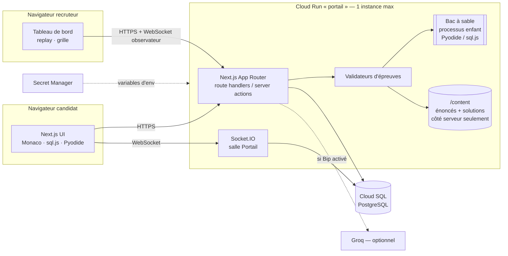

# Architecture — Le Portail

> Statut : proposition v1 (2026-11-10). À valider avant de coder.
> Principe directeur : **une seule application, une seule base, un seul
> service Cloud Run**. On ajoute une pièce seulement quand une contrainte
> l'impose.

## 1. Hypothèses retenues

| Sujet | Décision | Origine |
|---|---|---|
| Volume | Quelques entretiens / semaine, **1 à 3 sessions simultanées** max | Réponse utilisateur |
| Accès candidat | **Lien unique à jeton**, valable sur un créneau ; même lien utilisable sur un PC du bureau (présentiel) | Réponse utilisateur |
| Binôme | **Deux candidats** sur le même créneau, en appel Teams (le recruteur peut y être). La voix passe par Teams, pas par l'application | Réponse utilisateur |
| Replay | **Événements clés + instantanés du code** (~ toutes les 5 s quand il change) | Réponse utilisateur |
| Recruteurs | Google Workspace d'abord, Microsoft 365 (Entra ID) ensuite (Auth.js) ; faux fournisseur en dev | Décision 2026-11-12 |
| Portail | S'ouvre dès que les 2 ont leurs 4 gemmes, au plus tard à T0+33 ; pilote / copilote à vues asymétriques | Décision 2026-11-12 |
| Replays | Conservés 6 mois, annoncé au candidat au démarrage | Décision 2026-11-12 |

## 2. Vue d'ensemble



Un seul processus Node sert les pages, l'API, le temps réel et pilote le
bac à sable. Le bac à sable est un **processus enfant séparé** (pas un
simple thread), lancé sans variables d'environnement.

## 3. Choix et justifications

### 3.1 Application : Next.js + serveur personnalisé (Socket.IO)

Socket.IO a besoin d'intercepter l'« upgrade » HTTP ; l'App Router ne le
permet pas. On démarre donc Next.js via un petit `server.ts` qui crée le
serveur HTTP, y attache Socket.IO et délègue le reste à Next.

**Décision validée (2026-11-10), CLAUDE.md mis à jour** : la documentation Next.js indique que la
sortie `standalone` ne trace pas les fichiers d'un serveur personnalisé et
génère son propre `server.js` ; les deux ne se combinent pas proprement.
Proposition : **abandonner `output: "standalone"`**, image Docker
multi-étapes avec `npm ci --omit=dev` + `.next` + `server.js` compilé
(esbuild). Image plus lourde (~300–400 Mo au lieu de ~150 Mo), sans impact
notable sur le coût.

Alternatives écartées :
- *Socket.IO dans un 2ᵉ service Cloud Run* : deux déploiements, deux
  démarrages à froid, CORS et partage de session à gérer.
- *Bricoler le `server.js` du mode standalone* : fragile à chaque montée
  de version de Next.
- *Remplacer le temps réel par du polling HTTP* : faisable pour 2
  personnes, mais l'éditeur partagé et l'observation live seraient
  saccadés ; Socket.IO est déjà dans la stack.

### 3.2 Une seule instance → état temps réel en mémoire

Avec `max-instances=1`, tous les sockets arrivent sur le même processus :
**pas d'adaptateur Redis**. L'état éphémère (présence, qui tient le
clavier) vit en mémoire ; tout ce qui compte (code, événements, gemmes)
est écrit en base. Si Cloud Run redémarre l'instance, les clients se
reconnectent et rechargent le dernier instantané.

Écartés : adaptateur Redis / Memorystore (≈ 35 $/mois minimum, inutile à
1 instance), Firestore temps réel (2ᵉ base de données).

Limite assumée : le timeout Cloud Run de 3600 s coupe un WebSocket au
bout d'une heure ; la session dure 45 min et le client se reconnecte
automatiquement de toute façon.

### 3.3 Éditeur partagé du Portail : pilote / copilote

Le binôme est déjà en appel Teams : on applique le modèle classique de
pair programming **pilote / copilote**. Un seul candidat tient le clavier
(verrou côté serveur), l'autre voit le code en direct et peut
« demander la main ». Le pilote diffuse le contenu (debounce ~150 ms),
le serveur le relaie et l'enregistre en instantané.

- Simple, sans conflit d'édition possible.
- Lisible au replay : qui a tapé quoi, combien de passages de clavier.

**Vues asymétriques (décision du 2026-11-12)** : pour forcer la
communication, chaque rôle ne voit qu'une partie de l'information.

| Rôle | Voit | Ne voit pas |
|---|---|---|
| Pilote (clavier) | l'éditeur de code, le résultat « X / Y tests » | les logs, le contexte client |
| Copilote | les logs d'exécution, le ticket / contexte client, les exemples | le code |
| Recruteur (observateur) | tout | — |

- Le serveur n'envoie à chaque socket **que** les données de sa vue (le
  filtrage est côté serveur, pas un simple masquage CSS).
- « Demander la main » échange les rôles **et donc les vues** ; chaque
  échange est journalisé.
- Le contenu du Portail gagne deux champs publics : `logs` et
  `clientContext` (étape 8).

Réglages par défaut, à ajuster après les premiers entretiens : échange de
rôles libre, logs rafraîchis à chaque exécution du pilote.

Écarté pour la v1 : **Yjs / CRDT** (édition simultanée). Plus riche mais
ajoute un fournisseur Socket.IO maison, la persistance de documents Yjs et
des cas de bord. Réversible plus tard sans toucher au reste.

### 3.4 Sécurité des solutions (règle n°1)

Les solutions et tests cachés ne sortent jamais du serveur. Défense en
profondeur :

1. **Séparation du contenu** : chaque épreuve de `/content` exporte une
   partie `public` et une partie `private`, validées par Zod. Les modules
   de chargement importent `server-only` (le build échoue si un composant
   client les importe). Le client ne reçoit qu'un DTO construit
   explicitement par `toPublic()`.
2. **Canaris** : chaque solution contient une chaîne canari unique. Un
   test CI fait un `next build` puis cherche ces canaris dans
   `.next/static` → échec si trouvés.
3. **Validation exclusivement serveur** : la réponse au candidat se limite
   à « réussi / X tests sur Y » et un message générique. Jamais la valeur
   attendue, jamais la sortie standard d'un test caché.
4. **Anti-codage en dur** : SQL et algo sont aussi validés sur un **jeu de
   données caché** dérivé de la graine (`seed` → `seed'`), différent de
   celui que voit le candidat.
5. **Bac à sable** (voir 3.5).
6. **Bip** ne reçoit jamais les solutions dans son contexte.
7. **Limitation de débit** des soumissions (ex. 1 / 3 s par épreuve).

### 3.5 Exécution du code candidat côté serveur

Code : `src/server/sandbox/pool.ts` (parent), `sandbox/child.mjs` (enfant),
tests : `src/server/sandbox/sandbox.test.ts`.

**Décision validée (2026-11-12) : Node 26 LTS.** Node 24 n'a pas de
permission réseau ; or un code qui s'évade de Python vers JS (c'est facile :
`pyodide_js.constructor.constructor`) pourrait interroger le serveur de
métadonnées Cloud Run, obtenir le jeton du compte de service (Secret
Accessor) et lire tous les secrets. Node ≥ 25 refuse le réseau sous
`--permission` sans `--allow-net`.

Un **processus enfant Node** (`child_process.spawn`, pas `fork` : pas de
canal IPC) par exécution. La frontière de sécurité est ce processus et ses
drapeaux, pas Python :

- `env: {}` → aucun secret visible (sous Windows, libuv réinjecte quelques
  variables système non secrètes ; sous Linux l'env est vide) ;
- **modèle de permissions Node** (`--permission`) : lecture limitée aux
  dossiers de Pyodide, de sql.js et au script enfant ; **aucune écriture,
  aucun réseau, ni `child_process`, ni workers, ni addons, ni inspecteur,
  ni WASI, ni FFI**. Cela couvre aussi `/proc/<ppid>/environ` (secrets du
  parent) et le montage du vrai disque via `NODEFS` ;
- `--disallow-code-generation-from-strings` : ferme l'évasion Python →
  `Function` → contexte global JS (Pyodide fonctionne sans `eval`) ;
- Pyodide chargé avec un `jsglobals` vide ; `fetch`, `WebSocket`… supprimés ;
  `pyodide_js`, `pyodide.code`, `pyodide.http`, `micropip` bloqués à
  l'import ; `process.kill`, `dlopen`… neutralisés (non couverts par le
  modèle de permissions). Défense en profondeur seulement : contournable ;
- délai (5 s Python, 2 s SQL, 10 s max) mesuré par le parent →
  `SIGKILL`, résultats partiels conservés cas par cas ;
- mémoire : chaque mémoire WASM plafonnée à 256 Mo (on intercepte
  `WebAssembly.Memory.prototype.grow`, utilisé par emscripten) → `MemoryError`
  Python / `SQLITE_NOMEM` propres ; tas JS plafonné (`--max-old-space-size`) ;
  sous Linux, le parent lit aussi la mémoire résidente (`/proc/<pid>/status`)
  et tue l'enfant au-delà de 600 Mo ;
- sortie Python tronquée à 64 Ko ; tout ce que l'enfant écrit vers le parent
  est plafonné à 512 Ko (sinon l'enfant est tué : `output_limit`) ;
- **l'enfant ne reçoit jamais les attendus des tests** : seulement les
  entrées ; il renvoie les sorties en JSON et la comparaison se fait dans le
  parent. Un espace de noms Python neuf par cas de test ;
- SQL : base générée pour chaque exécution, `PRAGMA query_only = 1`, une
  seule instruction ;
- **utilisateur Linux dédié** (`SANDBOX_USER=bac`, créé dans l'image, sans
  shell ni dossier personnel) : même si le modèle de permissions de Node
  cédait, l'enfant ne peut ni lire `/proc/<serveur>/environ` ou sa mémoire,
  ni envoyer un signal au serveur, ni écrire dans `/app` (testé dans le
  conteneur, sans `--permission`). Changer d'utilisateur exige les droits
  root : le serveur reste donc root dans le conteneur (voir ci-dessous) ;
- **priorité CPU minimale** (`nice 19`, posé avant `exec` avec
  `/usr/bin/nice` pour que tous les threads de Node en héritent ; Docker et
  Cloud Run n'accordent pas `CAP_SYS_NICE`, et sous Linux la priorité est
  propre à chaque thread) : le serveur web et Socket.IO passent d'abord.
  Sous Windows (dev), priorité « basse » du processus ;
- **moteurs chargés en local uniquement** : Pyodide 314.0.7 et sql.js
  1.16.0 en versions exactes (empreintes `sha512` dans `package-lock.json`),
  lus dans `node_modules`. Pyodide est configuré pour ne jamais retomber
  sur son CDN (`packageBaseUrl`, `lockFileURL` et `packageCacheDir`
  locaux) ; aucun paquet supplémentaire (`numpy`…) n'est disponible.
  Le Pyodide côté navigateur (étape 7) devra être servi depuis
  l'application, même version.

**Serveur root, enfants « bac » (décision du 2026-11-12).** Seul un
processus root (ou doté de `CAP_SETUID`) peut lancer un enfant sous un
autre utilisateur. Alternatives écartées : `sudo -u bac` (le serveur ne
pourrait plus tuer l'enfant avec `SIGKILL`, qui n'est pas relayé) ;
capacités de fichier sur le binaire `node` (l'enfant, lui aussi `node`,
en hériterait). Root dans le conteneur n'ouvre au serveur rien de plus que
ce qu'il a déjà (les secrets sont dans son env) ; Cloud Run gen2 isole le
conteneur dans une micro-VM. Si un audit l'exige : un petit superviseur
root qui ne fait que lancer les enfants, et le serveur sous un utilisateur
non privilégié.

Un processus « chaud » (Pyodide déjà chargé, ~3–6 s) attend la tâche
suivante ; chaque processus est **jeté après usage** et son remplaçant n'est
préparé qu'après la fin de la tâche (un chargement en parallèle
ralentirait l'exécution chronométrée). Au plus **2 exécutions simultanées**,
file de 8, au-delà réponse `busy`. Budget : Next ~300–400 Mo + 1 chaud
~150 Mo + 2 × (256 Mo + surcoût) ≈ 1,2 Go → instance Cloud Run à
**2 Gio / 2 vCPU** (voir § 4). Le `Dockerfile` copie `sandbox/child.mjs`,
`node_modules/pyodide` et `node_modules/sql.js`.

Mesures (Docker Desktop, `node:26-bookworm-slim`) : chargement de Pyodide
seul 4–6 s ; processus du bac à sable prêt en 8–15 s avec 1 vCPU, 8–11 s
avec 2 vCPU. Piste d'amélioration : instantané mémoire de Pyodide.

Le **SQL du candidat ne touche jamais PostgreSQL** : il est exécuté dans
sql.js (SQLite WASM), dans le même bac à sable, sur une base générée
depuis la graine, puis comparé au résultat de la requête solution.

Risques résiduels acceptés : voir « Limites du bac à sable » ci-dessous.

Alternatives écartées :
- *Worker thread* : même processus, isolation plus faible.
- *Judge0 / Piston auto-hébergé* : service supplémentaire à maintenir.
- *API d'exécution tierce* : enverrait les tests cachés à l'extérieur.
- *Cloud Run Jobs / service « juge » séparé sans compte de service* :
  meilleure isolation mais démarrage à froid à chaque soumission et un 2ᵉ
  déploiement. **Plan B** si un audit de sécurité l'exige.

#### Limites du bac à sable (2026-11-12)

1. **Une évasion Python → JS reste possible** (Pyodide n'est pas conçu
   comme un bac à sable). Le code évadé reste enfermé par le modèle de
   permissions de Node, puis par l'utilisateur `bac`. Une faille de V8
   ou du noyau (élévation de privilèges) resterait une évasion complète :
   pas d'espace de noms ni de seccomp sur Cloud Run. Le réseau ne dépend
   que du modèle de permissions (Cloud Run ne filtre pas par processus) :
   d'où le droit d'accès secret par secret et la rotation des secrets en
   fin de campagne (DEPLOY.md).
2. **Signal vers le serveur** : impossible sous Linux avec l'utilisateur
   `bac` (testé : `EPERM`). En dev Windows (même utilisateur), seule la
   neutralisation de `process.kill` protège, et aucun chemin d'évasion
   connu vers `process` ne permet de la tester.
3. **Plafond RSS sous Linux seulement** ; ailleurs (dev Windows) on compte
   sur les plafonds WASM et du tas JS.
4. **Le code évadé pourrait contourner le plafond WASM** (il est posé en JS
   dans l'enfant) → reste le plafond RSS (Linux) et l'OOM du conteneur.
5. **Partage du CPU** : les enfants sont en `nice 19`, mais les délais
   sont mesurés en temps réel : un serveur très chargé peut faire échouer
   une exécution par « temps dépassé ». 2 vCPU limitent ce risque.
6. **Canal auxiliaire** : le code candidat voit les entrées cachées et peut
   en faire fuiter quelques bits par le motif réussite/échec ou la durée.
   Négligeable pour un entretien.
7. **Tests cachés et sortie standard** : le bac à sable renvoie stdout et
   les valeurs brutes ; c'est au validateur (étape 7) de n'exposer que
   « X / Y » pour les tests cachés.

### 3.6 Chrono serveur

`sessions.started_at` et `sessions.deadline` font foi. Le client calcule
l'écart avec l'heure serveur (renvoyée à chaque réponse) et n'affiche
qu'un compte à rebours. Toute soumission après `deadline` est refusée.
Les phases (gemmes / Portail) sont dérivées de l'heure serveur.

### 3.7 Déroulé d'un créneau en binôme

```
T0 ─── Phase gemmes (individuelle, ≤ 33 min) ───┬── Portail en binôme (≥ 12 min) ── T0+45
                                                 └ ouvre dès que les 2 ont leurs 4 gemmes,
                                                   au plus tard à T0+33 (décision du 2026-11-12)
```

- Les deux candidats démarrent au même `T0` (créneau du binôme) : `T0` est
  fixé par le premier clic sur « Commencer », possible à partir de l'heure
  prévue ; le second candidat partage ce `T0` (un retard se paie en temps).
  Ouvrir le lien ne lance pas le chrono (un aperçu de lien dans Teams ne
  doit rien déclencher).
- Règles des gemmes (2026-11-12) : Quiz = une tentative, gemme acquise
  quel que soit le résultat ; Logique = essais illimités, 5 s entre deux.
- À `T0+33`, le Portail s'ouvre même s'il manque des gemmes ; les gemmes
  manquantes sont journalisées et visibles du recruteur, jamais du
  candidat. En solo, même règle avec un seul candidat.
- Le plus rapide attend sur un écran « Le Portail s'éveille… » (bonus
  facultatif possible plus tard).
- **Repli solo** : si un candidat est absent, le recruteur bascule la
  session en Portail solo (même énigme).
- Le recruteur peut **observer en direct** la salle Portail (lecture
  seule), en plus du replay.

### 3.8 Accès candidat

1. Le recruteur crée un créneau (scénario, 1 ou 2 candidats, heure).
2. Chaque candidat reçoit un lien `/s/<jeton>` (32 octets aléatoires ; en
   base on ne stocke que son **hash SHA-256**).
3. Le lien n'est valable que de `créneau − 15 min` à `créneau + 2 h`.
4. À l'ouverture, il est échangé contre un cookie `httpOnly`, `Secure`,
   `SameSite=Lax` lié à la session. Réouverture sur un autre appareil
   possible (crash, PC du bureau) mais **journalisée** et visible au
   replay.
5. Présentiel : le recruteur ouvre le lien sur le PC du bureau, en
   fenêtre privée.
6. Écran d'accueil : avant de démarrer, le candidat est informé que ses
   actions sont enregistrées pour le replay et **conservées 6 mois**
   (décision du 2026-11-12). Le démarrage vaut prise de connaissance et
   est journalisé.

Écartés : comptes candidats (friction inutile pour 45 min), lien magique
par email (dépend d'un service d'envoi).

### 3.9 Recruteurs

**Décision du 2026-11-12 : Google Workspace d'abord, Microsoft 365
(Entra ID) ensuite.** La règle d'autorisation est indépendante du
fournisseur : une fonction `isAllowedRecruiter(profil)` vérifie l'email
vérifié et le domaine (`RECRUITER_EMAIL_DOMAIN`). Ajouter Entra ID =
déclarer un fournisseur de plus dans Auth.js et brancher le contrôle de
son tenant (`tid`) ; rien d'autre ne change.

- **Google** : paramètre `hd=<domaine>` **et** vérification serveur dans
  le callback `signIn` (`email_verified` + domaine), car `hd` seul est
  contournable.
- **Microsoft Entra ID** (plus tard) : application mono-tenant + contrôle
  du `tid` et du domaine dans le même callback.
- **Faux fournisseur en dev** : un fournisseur « Connexion de test » qui
  accepte un email du domaine autorisé sans mot de passe. Il n'existe que
  si `NODE_ENV !== "production"` **et** `AUTH_DEV_LOGIN=true` ; un test
  vérifie qu'il est absent en production.

Sessions **JWT** (pas de tables d'adaptateur), durée 8 h. Toutes les
routes `/recruteur/*` et les données de notation sont protégées côté
serveur.

### 3.10 Contenu et graine

- `/content/<scenario>/` en **TypeScript** + schémas Zod : les
  générateurs de données sont du code, le typage évite les fautes.
- Un PRNG déterministe (mulberry32) initialisé par `sessions.seed`
  produit : variante choisie, jeu de données SQL, valeurs de l'énigme
  logique, jeu caché (`seed'`).
- Le moteur (`/src`) ne connaît aucun scénario par son nom ; il charge
  un registre.

Écarté : YAML/Markdown pour tout le contenu — lisible par des
non-développeurs mais les générateurs restent du code ; on pourra mettre
seulement les textes en Markdown plus tard si les RH veulent les éditer.

### 3.11 Journal d'événements et replay

Table `events` en **ajout seul** : `(session_id, seq, ts, actor, type,
payload jsonb)`. Le client envoie par lots (toutes les 2–5 s et à chaque
action importante). Types : `stage.enter`, `code.snapshot`, `run`,
`submit`, `result`, `hint`, `portal.keyboard`, `bip.ask`, `reconnect`,
`focus.lost`…

Ordre de grandeur : ~600 instantanés × quelques Ko ≈ quelques Mo par
session → négligeable pour 10 Go.

Le replay = rejouer les événements sur une frise avec un Monaco en
lecture seule. Écarté : enregistrement DOM (rrweb) ou vidéo — volumineux
et moins exploitable pour noter.

### 3.12 Modèle de données (v1)

| Table | Rôle |
|---|---|
| `slots` | créneau : scénario, heure, mode (solo/binôme), statut |
| `sessions` | un candidat dans un créneau : hash du jeton, graine, `started_at`, `deadline`, gemmes obtenues |
| `events` | journal d'actions (replay) |
| `portal_rooms` | état persistant du Portail : code courant, pilote, résultat |
| `evaluations` | grille de compétences + adéquation par profil, par recruteur |

Les notes et l'adéquation ne sont exposées que par des routes recruteur.

### 3.13 Assistant Bip

Interface `Assistant { ask(ctx, question): Promise<Answer> }` avec
`GroqAssistant` et `FakeAssistant` (tests). Désactivé par défaut
(`BIP_ENABLED=false`). Contexte envoyé : énoncé public + code du candidat,
**jamais** la partie `private`. Chaque échange est journalisé.

## 4. Hébergement et coûts

Conforme à CLAUDE.md, avec ces précisions :

- Cloud Run : **2 vCPU** (bac à sable, voir DEPLOY.md § 4), **2 Gio**,
  facturation CPU à l'instance, `min=0`, `max=1`, affinité de session,
  timeout 3600 s, concurrence 80.
- Compte de service dédié : `roles/cloudsql.client` et
  `roles/secretmanager.secretAccessor` **accordé secret par secret** sur
  les seuls secrets `portail-*`, jamais au niveau du projet. **Rotation de
  tous les secrets à la fin de chaque campagne** (procédure : DEPLOY.md
  § 3), pour qu'un secret qui aurait fuité devienne inutile.
- Démarrage à froid (~5–10 s) : le recruteur ouvre son tableau de bord
  quelques minutes avant le créneau, ce qui réveille l'instance.
- Cloud SQL arrêté hors 8h–20h semaine : un entretien hors de cette plage
  nécessite de rallumer la base à la main.
- Migrations Drizzle exécutées au démarrage du conteneur (verrou
  consultatif PostgreSQL), ce qui est sûr à 1 instance.

Ordre de grandeur (à confirmer avec le simulateur de prix GCP) : Cloud SQL
db-f1-micro allumé ~60 h/semaine + 10 Go HDD ≈ 5 $/mois ; Cloud Run
quelques heures actives/semaine ≈ quelques $ ; Secret Manager et Scheduler
≈ 0. **Total visé : < 15 $/mois.**

Écartés : GKE (coût fixe), App Engine Flexible (pas de scale-to-zero),
SQLite sur Cloud Run (disque éphémère), base hors GCP (Neon, Supabase —
hors contrainte d'hébergement).

## 5. Questions ouvertes

1. ~~**Standalone**~~ : abandonné, validé le 2026-11-10 (§ 3.1).
2. ~~**Portail**~~ : s'ouvre dès que les deux ont leurs 4 gemmes, au plus
   tard à `T0+33` (2026-11-12, § 3.7).
3. ~~**RGPD**~~ : conservation 6 mois, annoncée au candidat en début de
   session ; purge automatique à l'étape 13 (2026-11-12, § 3.8).
4. **Grille de compétences** et **profils** : fournis avant l'étape 9.
5. **Domaine** autorisé pour les recruteurs (`RECRUITER_EMAIL_DOMAIN`) et
   identifiants OAuth Google : nécessaires seulement pour la vraie
   connexion ; le dev utilise le faux fournisseur.
6. **Microsoft 365 (Entra ID)** : à ajouter après Google (§ 3.9).
7. ~~**Portail en binôme**~~ : pilote / copilote avec vues asymétriques
   (2026-11-12, § 3.3).
